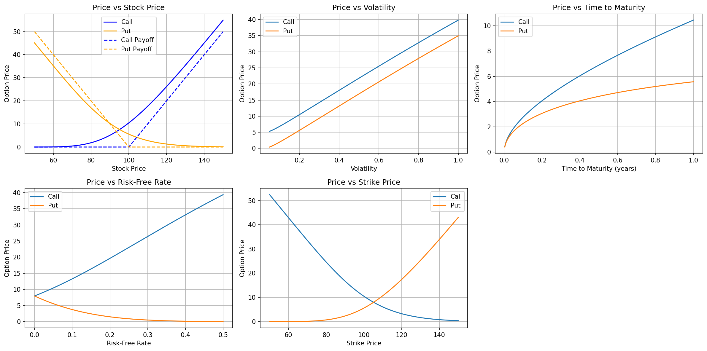
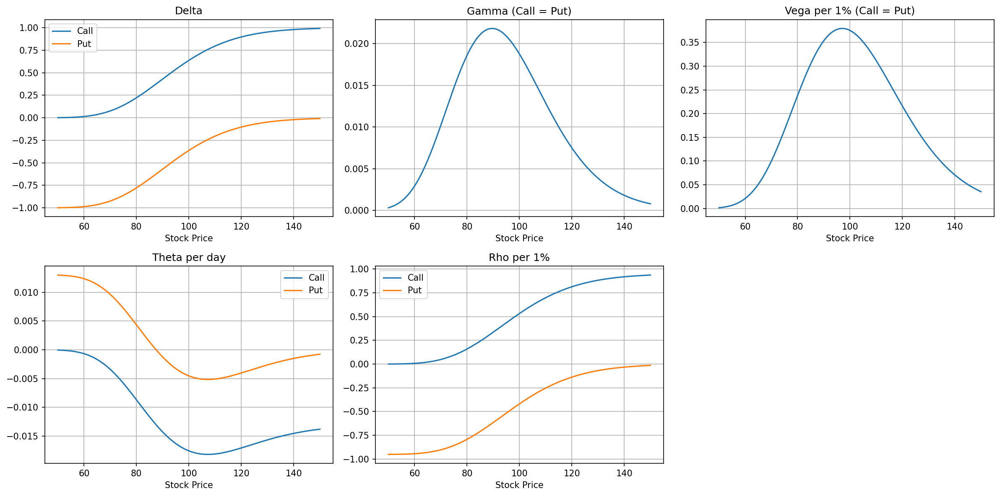
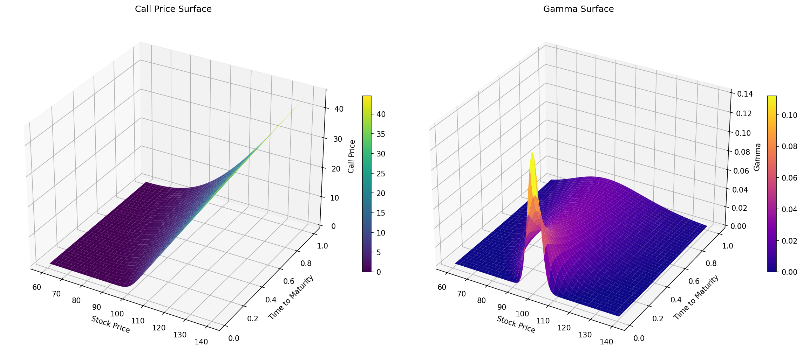

# Black-Scholes Option Pricing and Sensitivity Analysis

A Python implementation of the Black-Scholes model for pricing European call and put options, calculating option Greeks, visualizing parameter sensitivities, and validating results with put-call parity.

## Overview

This project explores how the Black-Scholes model responds to changes in its key inputs. The analysis is presented in a Jupyter Notebook, with explanations, numerical results, and visualizations.

### What is included

* Closed-form pricing functions for European call and put options
* Analytical calculation of **Delta, Gamma, Vega, Theta, and Rho**
* Price sensitivity analysis for the stock price, strike price, time to maturity, volatility, and risk-free rate
* Plots of the five Greeks as functions of the underlying stock price
* 3D surfaces for call price and Gamma across stock prices and times to maturity
* Numerical validation of **put-call parity**, including a check across 200 stock prices
* Discussion of model assumptions, limitations, and possible extensions

## Baseline Example

The notebook uses the following illustrative inputs:

| Parameter              |  Value | Description                          |
| ---------------------- | -----: | ------------------------------------ |
| Stock price (`S`)      |    100 | Current underlying stock price       |
| Strike price (`K`)     |    100 | Option strike price                  |
| Time to maturity (`T`) | 1 year | Time remaining until expiration      |
| Risk-free rate (`r`)   |     5% | Annual, continuously compounded rate |
| Volatility (`sigma`)   |    20% | Annualized volatility                |

The resulting option prices are:

| Output                               |    Call |     Put |
| ------------------------------------ | ------: | ------: |
| Option price                         | 10.4506 |  5.5735 |
| Delta                                |  0.6368 | -0.3632 |
| Gamma                                |  0.0188 |  0.0188 |
| Vega (per 1 percentage-point change) |  0.3752 |  0.3752 |
| Theta (per calendar day)             | -0.0176 | -0.0045 |
| Rho (per 1 percentage-point change)  |  0.5323 | -0.4189 |

These values are generated from the model using the inputs above; they are examples, not quotes from a live options market. The notebook also verifies that the call-price/put-price difference matches the theoretical put-call parity value for the baseline inputs and for 200 stock-price values.

## Visualizations

### Option Price Sensitivity

The first figure compares call and put prices as one model input changes at a time, holding the other inputs at their baseline values.

### Greeks vs. Stock Price

The second figure plots Delta, Gamma, Vega, Theta, and Rho against the underlying stock price.

### 3D Surfaces

The third figure visualizes the call price and Gamma as functions of stock price and time to maturity.

## Model Assumptions and Limitations

The implementation uses the standard Black-Scholes framework with these assumptions:

* The options are European-style and can be exercised only at expiration.
* The underlying stock pays no dividends.
* Volatility and the risk-free rate are constant over the option's life.
* The underlying follows geometric Brownian motion.
* Trading is frictionless under the model's idealized assumptions.

The project uses illustrative parameters rather than live market data. Real-world pricing can differ due to dividends, volatility smiles/skews, changing interest rates, bid-ask spreads, transaction costs, liquidity, and contract-specific features. The implementation is not a model for American-style early exercise.

## Possible Extensions

* Estimate implied volatility from observed option prices
* Estimate volatility from historical underlying returns
* Compare the analytical Black-Scholes price with Monte Carlo estimates
* Explore dividend-paying stocks or alternative option-pricing models
* Simulate delta hedging and option-strategy payoffs

## Disclaimer

This repository is for educational and research purposes only. It is not investment advice and should not be used as the sole basis for trading or investment decisions.
